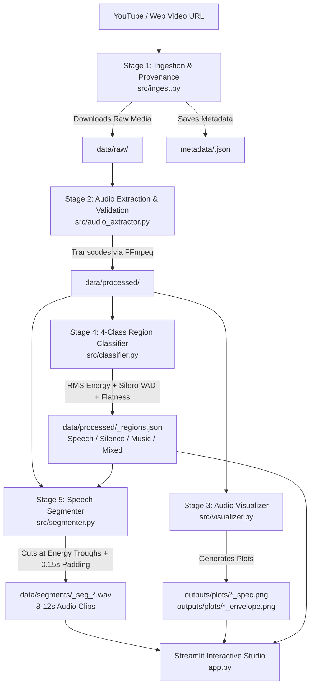
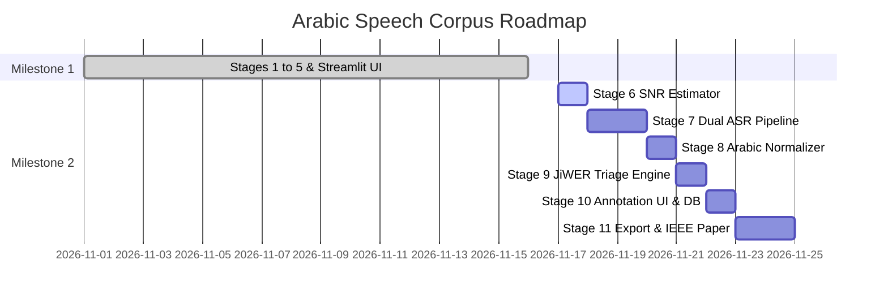

# Arabic Labelled Speech Corpus — Project Context & System Specification

> **Document Type:** Comprehensive Architectural, Implementation, and Technical Specification  
> **Target Audience:** External Large Language Models (LLMs), AI Collaborators, Senior Software Architects  
> **Last Codebase Verification:** November 16, 2026  
> **Repository Location:** `C:\Speech_2_Text\speech-to-text-corpus`  
> **Version:** 1.0.0-milestone1  

---

## Table of Contents
1. [A. Project Overview](#a-project-overview)
2. [B. Functional Requirements](#b-functional-requirements)
3. [C. Technical Stack](#c-technical-stack)
4. [D. Architecture and System Design](#d-architecture-and-system-design)
5. [E. Repository Structure](#e-repository-structure)
6. [F. Implementation Details](#f-implementation-details)
7. [G. Data and Interfaces](#g-data-and-interfaces)
8. [H. Environment and Execution](#h-environment-and-execution)
9. [I. Current Implementation Status](#i-current-implementation-status)
10. [J. Known Issues and Technical Debt](#j-known-issues-and-technical-debt)
11. [K. Development History and Key Decisions](#k-development-history-and-key-decisions)
12. [L. Roadmap and Next Steps](#l-roadmap-and-next-steps)
13. [M. Important Context and Constraints](#m-important-context-and-constraints)

---

## A. Project Overview

### 1. Project Identification
- **Project Name:** Arabic Labelled Speech Corpus (`speech-to-text-corpus`)
- **Domain:** Speech Processing, Automatic Speech Recognition (ASR), Natural Language Processing (NLP), Corpus Linguistics
- **Repository Root:** `C:\Speech_2_Text\speech-to-text-corpus`
- **Academic Context:** Course project for Digital Signal Processing / Speech Processing at Cairo University (Faculty of Engineering, Computer Engineering Department). Course Instructor / Lecturer: **Dr. Mohsen Rashwan**.

### 2. What the Project Does
The project is an end-to-end, reproducible, 11-stage automated and human-in-the-loop pipeline designed to build a high-quality, standardized, phonetically safe Arabic labelled speech dataset from diverse online multimedia sources (e.g., academic lectures, interviews, conversational media).

The pipeline ingests raw audio/video, preserves provenance metadata, extracts standardized 16 kHz mono WAV streams, classifies acoustic regions (speech, silence, music, mixed) via multi-signal fusion, slices continuous speech into standardized 8–12 second clips without clipping words mid-phoneme, generates dual-engine ASR candidate transcripts, normalizes Arabic orthography deterministically, triages engine disagreements via word error rate metrics, provides an interactive Streamlit verification workbench, and packages the verified corpus into standard manifests alongside an IEEE-format scientific report.

### 3. Problem It Solves
- **Scarcity of Dialectal and Domain-Specific Arabic Audio Corpora:** Arabic ASR systems suffer from a lack of clean, standardized, well-segmented speech data with dialectal diversity and proper acoustic metadata.
- **Mid-Word Phoneme Clipping in Automated Slicers:** Standard VAD or fixed-duration splitters frequently truncate words at phoneme boundaries, severely corrupting ASR training and evaluation targets.
- **Reproducibility & Provenance Void:** Most published datasets lack strict provenance tracking (original URLs, tools, license status, extraction timestamps) and audit trails for human corrections.
- **High-Resource Dependency:** Many academic workflows rely on paid cloud APIs (Google Cloud Speech, OpenAI Whisper API). This project is engineered to run **100% locally and free of charge** within consumer laptop hardware constraints (16 GB RAM, 8 GB VRAM).

### 4. Intended Users & Stakeholders
- **Academic Researchers & Students:** University evaluators analyzing signal processing workflows, VAD accuracy, and Arabic ASR benchmarks.
- **ASR & NLP Engineers:** Developers fine-tuning acoustic models (e.g., Whisper, Meta MMS, Wav2Vec2-BERT) on conversational Arabic.
- **Annotators & Reviewers:** Human evaluators using the interactive Streamlit dashboard to verify cuts, correct transcripts, and review disagreement cases.

### 5. Main Objectives
1. Build a modular 11-stage pipeline where every stage is independently executable, testable, and idempotent.
2. Ingest and process at least 3 distinct Arabic audio sources representing different acoustic conditions (e.g., university lecture hall, conversational video, music/studio).
3. Enforce strict 16 kHz, single-channel (mono), 16-bit linear PCM (`PCM_16`) standardization.
4. Guarantee phoneme-safe segmentation: clips strictly between 5.0s and 15.0s (target 8.0s–12.0s) cut exclusively at natural energy troughs with ±0.15s edge cushion padding.
5. Perform dual local ASR decoding (`faster-whisper-large-v3-turbo` + a local open-source Arabic model like Meta MMS 1B), followed by deterministic Arabic orthographic normalization and JiWER triage.
6. Deliver an interactive Streamlit UI for pipeline orchestration, audio playback, spectrogram inspection, and annotation audit.
7. Generate a final HuggingFace-compatible dataset manifest and a 10–12 page IEEE-style technical paper.

### 6. Current Development Stage
- **Milestone 1 (Complete & Fully Verified):** Stages 1 through 5 are implemented, tested, and integrated.
  - Stage 1: Ingestion & Provenance Metadata (`src/ingest.py`)
  - Stage 2: Audio Extraction & Format Validation (`src/audio_extractor.py`)
  - Stage 3: Waveform & Spectrogram Visualization (`src/visualizer.py`)
  - Stage 4: 4-Class Region Classification (`src/classifier.py`)
  - Stage 5: Energy-Trough Speech Segmentation (`src/segmenter.py`)
  - Master Pipeline Orchestrator (`src/pipeline.py`)
  - Interactive Streamlit Dashboard (`app.py`)
  - 3 recordings ingested in `metadata/` and processed into `data/processed/`.
- **Milestone 2 (Planned & In Progress):** Stages 6 through 11 (SNR estimation, Dual ASR, Arabic normalization, JiWER triage, JSON-backed Streamlit annotation, dataset export, IEEE paper).

### 7. Expected Final Deliverables
1. Standardized dataset of 8–12 second clips (`data/segments/*.wav`) with edge cushion padding.
2. Complete provenance JSON files for all source recordings (`metadata/*.json`).
3. Classified acoustic region files (`data/processed/*_regions.json`).
4. Master segment manifest (`metadata/corpus_manifest.csv` / `.jsonl`) linking audio paths, timestamps, dual ASR hypotheses, normalized text, human ground truth, SNR, and audit history.
5. Interactive Streamlit review studio with JSON-backed audit trails.
6. 10-minute gold-standard manually annotated test split.
7. IEEE-format research paper (10–12 pages) detailing methodology, acoustic calibration, VAD fusion, WER comparison, and dataset statistics.

---

## B. Functional Requirements

### 1. Verified & Implemented Features (Stages 1–5)

#### Stage 1: Media Ingestion & Provenance Recording (`src/ingest.py`)
- **Target URL Querying:** Accepts YouTube/web URLs; extracts video ID, title, uploader/channel, channel ID, upload date, duration, description, and license using `yt-dlp` without initial media download.
- **Duplicate & Cache Detection:** Checks `data/raw/` for existing files matching `*{video_id}*` to prevent redundant network downloads and bandwidth throttling.
- **Audio Stream Acquisition:** If not present locally, downloads the highest-quality audio stream to `data/raw/<sanitized_title>_<video_id>.<ext>`.
- **Safe Filename Sanitization:** Cleans illegal Windows/Linux characters (`\ / : * ? " < > |` etc.), preserves Arabic characters and alphanumeric strings, and bounds filename length to 50 characters before appending `_<video_id>`.
- **Provenance JSON Export:** Writes a permanent, portable, UTC-timestamped JSON record to `metadata/<video_id>.json`. Relative paths are used for cross-platform portability.

#### Stage 2: Audio Extraction & Format Validation (`src/audio_extractor.py`)
- **FFmpeg Subprocess Transcoding:** Direct command-line invocation of FFmpeg to convert arbitrary audio/video containers (`.mp4`, `.m4a`, `.webm`, `.mkv`) into the exact target format:
  $$\text{Sample Rate} = 16,000 \text{ Hz}, \quad \text{Channels} = 1 \text{ (Mono)}, \quad \text{Encoding} = \text{Signed 16-bit PCM (PCM\_16)}, \quad \text{Container} = \text{WAV}$$
- **Dynamic FFmpeg Discovery:** Resilient 3-tier discovery:
  1. Standard `shutil.which('ffmpeg')` in system `PATH`.
  2. Windows Registry lookup (`HKEY_CURRENT_USER\Environment\Path`) to resolve IDE inherited PATH lag.
  3. WinGet package directory scanning (`%LOCALAPPDATA%\Microsoft\WinGet\Packages\**\ffmpeg.exe`).
- **Non-Destructive Guarantee:** Strict guard clause prevents overwriting raw source files.
- **Programmatic Quality Gate:** SoundFile `sf.info()` inspects the WAV header to verify sample rate, channel count, subtype (`PCM_16`), and format (`WAV`). Throws explicit `ValueError` if any parameter deviates.

#### Stage 3: Audio Visualization (`src/visualizer.py`)
- **Dual-Panel Inspection:** Computes and plots a synchronized dual-panel figure for any specified time window:
  - Top Panel: Time-domain waveform (amplitude vs. seconds).
  - Bottom Panel: Log-frequency STFT spectrogram using SciPy (frequency vs. seconds, dB intensity colorbar).
- **Peak Decimation Envelope:** Generates a full-file overview amplitude envelope for recordings of arbitrary length (e.g., 95+ minutes) using vectorised block peak decimation (`len(audio) // 4000`), preventing memory exhaustion.
- **Headless Plotting:** Automatically forces `matplotlib.use('Agg')` and redirects `MPLCONFIGDIR` to `PROJECT_ROOT/.cache/matplotlib` to eliminate Windows GUI thread hangs and permission errors.

#### Stage 4: 4-Class Region Classification (`src/classifier.py`)
- **Multi-Signal Fusion Decision Engine:** Classifies every 50 ms audio frame into one of four classes:
  1. `speech`: Human voice is the dominant signal.
  2. `silence`: Ambient background tone, inter-sentence pauses, room tone.
  3. `music`: Tonal/harmonic acoustic content without voice.
  4. `mixed`: Overlapping speech and music/noise or ambiguous voice activity.
- **Signal Components:**
  - *Signal A (RMS Energy in dB):* Non-overlapping 50 ms frames (800 samples at 16 kHz). Calibrated threshold: `SILENCE_THRESHOLD_DB = -31.0 dB` (calibrated against real lecture room tone measured at -33.8 dB).
  - *Signal B (Silero VAD Neural Network):* Lightweight pre-trained TorchScript model chunked in 30s segments with RNN state resets. Computes speech probability $P(\text{speech}) \in [0.0, 1.0]$.
  - *Signal C (Spectral Flatness / Wiener Entropy):* Ratio of geometric mean to arithmetic mean of the power spectrum to identify harmonic vs. broadband noise.
- **Smoothing & Region Merging:** Consecutive identical frames are merged. Regions under `MIN_REGION_DURATION_SEC = 1.5s` are absorbed into adjacent regions to prevent micro-pause label flickering.
- **Structured JSON Export:** Saves classified time intervals to `data/processed/<video_id>_regions.json`.

#### Stage 5: Speech Segmentation (`src/segmenter.py`)
- **Duration Envelopes:** Segments target 8.0s to 12.0s, with hard minimum of 5.0s and hard maximum of 15.0s.
- **Natural Energy Trough Slicing:** When a continuous speech region exceeds 15.0s, the slicer searches within the $[8.0\text{s}, 12.0\text{s}]$ window for the local minimum RMS energy frame (the quietest inter-word micro-pause).
- **Edge Silence Cushion:** Automatically prepends and appends $0.15\text{s}$ padding to every segment so leading plosives and trailing fricatives are preserved.
- **Audit Verification Flagging:**
  - If the minimum energy at the cut is $< -28.0 \text{ dB}$: tagged `auto_verified`.
  - If the cut point has higher energy: tagged `flagged_manual_review` for human verification.
- **Normalized Segment Storage:** Exports discrete 16-bit PCM WAV clips to `data/segments/<video_id>_seg_000001.wav` and returns a structured segment manifest.

#### Streamlit Web Dashboard (`app.py`)
- Interactive web UI built with Streamlit providing:
  - **View 1 (Pipeline Runner):** Enter any URL, set provenance notes, toggle Quick Test Mode, and run Stages 1–5 end-to-end.
  - **View 2 (Segment Browser):** Audio players for all generated `.wav` clips, showing duration, sample rate, and boundary verification badges.
  - **View 3 (Region & Audio Analysis):** Displays STFT spectrograms, full-file amplitude envelopes, and a filterable DataFrame of classified acoustic regions with speech/silence percentage metrics.

---

### 2. Features Currently Being Developed / Planned (Stages 6–11)

```
[Stages 1-5: Complete] ──► [Stage 6: SNR Estimation]
                                  │
                                  ▼
                           [Stage 7: Dual ASR Inference]
                                  │
                                  ▼
                           [Stage 8: Arabic Normalization]
                                  │
                                  ▼
                           [Stage 9: JiWER Triage Engine]
                                  │
                                  ▼
                           [Stage 10: Streamlit Annotation DB]
                                  │
                                  ▼
                           [Stage 11: Corpus Export & IEEE Paper]
```

- **Stage 6: Dual-Method SNR Estimation (`src/snr_estimator.py`):**
  - Implement two independent Signal-to-Noise Ratio estimation algorithms:
    1. *WADA-SNR (Waveform Amplitude Distribution Analysis):* Assumes Gamma-distributed clean speech and Gaussian noise; estimates SNR without requiring explicit noise-only segments.
    2. *NIST STNR (Speech-to-Noise Ratio) / Segmental SNR:* Uses Stage 4 classified speech vs. silence regions to calculate $10 \log_{10} \frac{P_{\text{speech}}}{P_{\text{silence}}}$.
  - Every segment will be tagged with both SNR values for acoustic quality stratification.
- **Stage 7: Dual-Engine ASR Transcription (`src/transcriber.py`):**
  - Engine A: `faster-whisper` (`large-v3-turbo` model) running via CTranslate2 on CUDA `float16`.
  - Engine B: Local HuggingFace Arabic speech model (e.g., `facebook/mms-1b-all` Arabic dialect or `jonatasgrosman/wav2vec2-large-xlsr-53-arabic`).
  - Strict sequential loading and explicit GPU VRAM clearing (`torch.cuda.empty_cache()`) between models to operate within the 8 GB VRAM budget.
- **Stage 8: Deterministic Arabic Text Normalization (`src/normalizer.py`):**
  - Strips all Arabic diacritics / Tashkeel (`Fatha`, `Damma`, `Kasra`, `Sukun`, `Shadda`, `Tanween`).
  - Strips Tatweel / Kashida (`ـ`).
  - Unifies Alef variants: `[إ أ آ ٱ]` $\rightarrow$ `ا`.
  - Unifies Taa Marbuta and Haa: `ة` $\rightarrow$ `ه` (or configurable standardized mapping).
  - Unifies Alef Maqsura and Yaa: `ى` $\rightarrow$ `ي`.
  - Removes Latin punctuation, symbols, and collapses repeated whitespace.
- **Stage 9: JiWER Disagreement Triage (`src/evaluator.py`):**
  - Computes Word Error Rate (WER) and Character Error Rate (CER) between normalized Hypothesis A and Hypothesis B using `jiwer`.
  - Classifies segments into three triage buckets:
    - `accepted` ($\text{WER} < 15\%$): Candidate transcript accepted automatically or with minimal review.
    - `review_needed` ($15\% \le \text{WER} \le 40\%$): Sent to the Streamlit human review queue.
    - `difficult` ($\text{WER} > 40\%$): High acoustic noise, overlapping talkers, or dialect mismatch; prioritized for manual listening.
- **Stage 10: Streamlit Annotation Workbench & Audit Trail (`app.py` extension):**
  - Dual audio players for candidate segments.
  - Side-by-side editable text boxes for ASR A vs. ASR B.
  - JSON transcript files (`data/transcripts/`) storing ground truth annotations and embedded audit trails for user edits.
- **Stage 11: Corpus Export & IEEE Paper:**
  - Export scripts producing standardized JSONL / CSV manifests (HuggingFace audio dataset schema).
  - Formal train / validation / test splits (stratified by speaker and duration).
  - Dedicated 10-minute gold-standard test sample with 100% human-verified audio and text.
  - 10–12 page IEEE format academic paper compiling all methodology, experimental evaluations, and acoustic analysis.

---

## C. Technical Stack

### 1. Languages and Runtimes
| Technology | Exact Version | Purpose | Verification Status |
|---|---|---|---|
| **Python** | `3.13.0` (64-bit) | Primary development runtime | Verified (`.venv`) |
| **PyTorch** | `2.14.1+cu132` | Neural network backend (Silero VAD, Transformers) | Verified (CUDA available) |
| **CUDA** | `13.2` | GPU acceleration for PyTorch and CTranslate2 | Verified via RTX 5060 |
| **FFmpeg** | `9.0.2-full_build-www.gyan.dev` | Audio decoding, transcoding, channel downmixing | Verified (WinGet & Registry) |
| **OS** | Windows 11 (64-bit) | Host operating system | Verified |

### 2. Core Python Libraries (from `requirements.txt`)
| Library | Category | Verified Role in Codebase |
|---|---|---|
| `soundfile` | Audio I/O | Header validation via `sf.info()`, sample reading/writing (`float32`, `PCM_16`) |
| `scipy` | Signal Processing | STFT spectrogram computation via `scipy.signal.stft` in visualizer |
| `numpy` | Array Operations | RMS frame energy computation, FFT spectral flatness, array slicing |
| `matplotlib` | Visualization | Dual-panel spectrogram/waveform and amplitude envelope generation (`Agg` backend) |
| `silero-vad` | Voice Activity | Pre-trained TorchScript voice activity detector for 4-class classification |
| `yt-dlp` | Web Acquisition | Metadata fetching, audio stream downloading, duplicate prevention |
| `faster-whisper` | Speech Recognition | High-performance CTranslate2 Whisper inference (`large-v3-turbo` model) |
| `transformers` | Speech Recognition | HuggingFace model runner for secondary Arabic ASR (Meta MMS / Wav2Vec2) |
| `streamlit` | User Interface | Interactive web dashboard (`app.py`) for pipeline execution and audio review |
| `pandas` | Data Handling | Region statistics aggregation, dataframe presentation, manifest tables |
| `jiwer` | Transcript Eval | Word Error Rate (WER) and Character Error Rate (CER) calculation |
| `tqdm` | CLI Utility | Progress meters for batch processing |
| `pydub`, `librosa` | Audio Utilities | Secondary audio utilities and spectral feature extraction |

### 3. Hardware Environment and Constraints
- **Host GPU:** NVIDIA GeForce RTX 5060 Laptop GPU (8 GB GDDR6 VRAM).
- **Host RAM:** 16 GB DDR5 System RAM.
- **CPU:** Intel/AMD x64 multi-core processor.
- **Storage:** Local NVMe SSD (`C:\Speech_2_Text\speech-to-text-corpus`).
- **GPU Execution Policy:**
  - 8 GB VRAM is sufficient for `faster-whisper-large-v3-turbo` (requires ~2.5 to 3.5 GB in `float16`).
  - Dual ASR models **cannot** be held in VRAM simultaneously without risk of Out-Of-Memory (OOM) errors. Models must be loaded and unloaded sequentially with explicit garbage collection and CUDA cache clearing.
- **Cost Policy:** Strict **\$0.00** budget constraint. No paid third-party APIs (OpenAI API, Google Cloud Speech, AWS Transcribe, ElevenLabs, etc.) are permitted.

---

## D. Architecture and System Design

### 1. Overall System Architecture
The project is built on a **Pipeline Orchestrator Pattern** coupled with **Stateless Functional Stages**. The master orchestrator (`src/pipeline.py`) coordinates execution across independent modular stages. Communication between stages occurs strictly via standardized disk assets (WAV files, JSON metadata records, and CSV manifests) rather than in-memory object passing, ensuring crash-resilience, idempotency, and independent reproducibility.



### 2. Design Patterns and Architectural Decisions

#### Decision 1: Non-Destructive Data Layering
The codebase enforces four strictly isolated directory layers:
1. `data/raw/`: Original media files downloaded from the web. Immutable; never modified or deleted.
2. `data/processed/`: Standardized full-length 16 kHz mono PCM_16 WAV files and classified region JSONs.
3. `data/segments/`: Individual 8–12 second sliced WAV clips.
4. `metadata/`: JSON provenance records and downstream annotation manifests.
*Reasoning:* If a downstream segmentation or classification parameter is re-tuned, upstream raw and processed assets remain intact, avoiding re-downloads and preserving auditability.

#### Decision 2: File-Based Loose Coupling
Modules do not maintain persistent in-memory global state or shared singleton objects. Each module can be executed from the CLI independently:
```powershell
python src/ingest.py <URL>
python src/audio_extractor.py
python src/visualizer.py
python src/classifier.py
python src/segmenter.py
```
*Reasoning:* Eliminates pipeline fragility. Any single stage can be re-run, profiled, or debugged without booting the entire pipeline.

#### Decision 3: Resilient Windows Environment Adaptations
1. **Dynamic FFmpeg Fallback:** IDE terminals on Windows often run with stale PATH variables. `check_ffmpeg_available()` checks `PATH`, then falls back to Windows Registry queries and WinGet directory scanning, dynamically updating `os.environ["PATH"]`.
2. **NVIDIA CUDA DLL Directory Registration:** On Python 3.13 / Windows, CTranslate2 and PyTorch CUDA libraries require `os.add_dll_directory()` for `.venv/Lib/site-packages/nvidia/*/bin` to load CUDA runtime DLLs cleanly.
3. **Headless Matplotlib Rendering:** Windows GUI display connections hang inside background tasks. Setting `matplotlib.use("Agg")` and a local `.cache/matplotlib` directory avoids all desktop window manager calls.

---

## E. Repository Structure

```text
C:\Speech_2_Text\speech-to-text-corpus\
│
├── .cache\                     # Local runtime cache (matplotlib fonts, whisper models)
├── .venv\                      # Python 3.13 isolated virtual environment
├── .vscode\                    # VS Code editor settings
│
├── data\                       # Non-destructive data storage layers
│   ├── raw\                    # Original untouched media (.m4a, .webm, .mp4)
│   ├── processed\              # Standardized 16 kHz mono WAV files and region JSONs
│   └── segments\               # Sliced 8–12s speech clips (<id>_seg_000001.wav)
│
├── metadata\                   # Provenance records (<video_id>.json) and manifests
│   ├── gK017cCH36k.json        # Video 1: DSP Lecture 1 (Dr. Mohsen Rashwan)
│   ├── E9-1sO7FCaA.json        # Video 2: Amr Diab (Rotana Arabic music)
│   └── jIr0Fw0fYsg.json        # Video 3: Mohab Shady (Egyptian Arabic vlog/talk)
│
├── notebooks\                  # Exploratory Jupyter notebooks
├── outputs\                    # Generated artifacts
│   └── plots\                  # Spectrogram PNGs and amplitude envelopes
│
├── src\                        # Core pipeline source code modules
│   ├── __init__.py             # Python package marker
│   ├── ingest.py               # Stage 1: Ingestion & metadata extraction via yt-dlp
│   ├── audio_extractor.py      # Stage 2: FFmpeg 16kHz mono WAV conversion & validation
│   ├── visualizer.py           # Stage 3: SciPy STFT spectrogram & envelope plotting
│   ├── classifier.py           # Stage 4: 4-class acoustic classification (VAD + energy)
│   ├── segmenter.py            # Stage 5: Energy-trough 8-12s speech slicer & padding
│   └── pipeline.py             # Master orchestrator coordinating Stages 1 through 5
│
├── tests\                      # Modular test suite
│   ├── gpu_test.py             # CUDA and faster-whisper GPU verification
│   ├── test_audio.py           # Generic audio inspector CLI utility
│   ├── test_audio_extractor.py # Tests for Stage 2 FFmpeg detection & SoundFile validation
│   ├── test_visualizer.py      # Tests for Stage 3 spectrogram and window generation
│   ├── test_classifier.py      # Tests for Stage 4 classification on 60s audio slice
│   └── test_segmenter.py       # Tests for Stage 5 segmentation limits, cuts & padding
│
├── app.py                      # Interactive Streamlit Web Dashboard
├── requirements.txt            # Python dependencies specification
├── .gitignore                  # Git exclude rules (data, .venv, cache, outputs)
├── LICENSE                     # Project license
├── Readme.md                   # Legacy initial project readme
├── PROJECT_CONTEXT.md          # Comprehensive self-contained project specification (this document)
└── LLM_BOOTSTRAP_PROMPT.md     # Instructions for external LLM onboarding
```

### Module Responsibilities & Dependencies

| Module | Primary Responsibility | Upstream Dependencies | Downstream Consumers |
|---|---|---|---|
| `src/audio_extractor.py` | Transcode media to 16kHz mono PCM_16 WAV via FFmpeg; validate headers | FFmpeg CLI, `soundfile` | `src/ingest.py`, `tests/test_audio_extractor.py` |
| `src/ingest.py` | Query metadata, download raw audio, trigger Stage 2, write JSON record | `yt-dlp`, `src.audio_extractor` | `src/pipeline.py`, `app.py` |
| `src/visualizer.py` | Compute STFT spectrograms and peak-decimated amplitude envelopes | `scipy`, `matplotlib`, `soundfile` | `src/pipeline.py`, `app.py` |
| `src/classifier.py` | 50ms frame RMS energy, Silero VAD, region merging, 4-class classification | `silero_vad`, `torch`, `numpy`, `soundfile` | `src/segmenter.py`, `src/pipeline.py`, `app.py` |
| `src/segmenter.py` | Energy-trough slicing (8–12s), edge cushion padding (0.15s), WAV export | `src.classifier`, `soundfile`, `numpy` | `src/pipeline.py`, `app.py` |
| `src/pipeline.py` | Orchestrate Stages 1 through 5 end-to-end; CLI entry point | All `src.*` modules | Interactive user, automated batch jobs |
| `app.py` | Web UI for running pipeline, browsing segments, inspecting plots & metrics | `streamlit`, `src.pipeline`, `soundfile` | End-user / Human Annotators |

---

## F. Implementation Details

### 1. Stage 1: Ingestion & Provenance (`src/ingest.py`)

#### Key Functions
- `get_ytdlp_version() -> str`: Returns the active `yt_dlp.version.__version__` to ensure metadata auditability.
- `fetch_video_metadata(url: str) -> dict`: Instantiates `yt_dlp.YoutubeDL({'quiet': True, 'no_warnings': True})` with `download=False` to fetch metadata dict without pulling media bytes.
- `sanitize_title(title: str, max_length: int = 50) -> str`: Uses regex `re.sub(r'[\\/*?:"<>|#%&{}\\<>*?/$!\'":@+`|=]', '_', title)` to create OS-safe stems while preserving Arabic unicode characters.
- `find_existing_raw_file(video_id: str) -> Optional[Path]`: Globs `RAW_DIR.glob(f"*{video_id}*")` across valid audio extensions (`.m4a`, `.webm`, `.mp4`, `.wav`, etc.) to prevent redundant downloads.
- `find_existing_processed_wav(video_id: str) -> Optional[Path]`: Globs `PROCESSED_DIR.glob(f"*{video_id}*.wav")` for existing converted audio.
- `ingest_video(url: str, notes: Optional[str] = None, custom_license: Optional[str] = None) -> dict`: Main workflow function coordinating metadata querying, media download, Stage 2 extraction invocation, validation, and JSON record saving.

---

### 2. Stage 2: Audio Extractor & Quality Gate (`src/audio_extractor.py`)

#### Key Functions
- `check_ffmpeg_available() -> str`: Resilient 3-step FFmpeg detection. Returns executable path or raises descriptive `RuntimeError`.
- `extract_audio(input_path, output_path, sample_rate=16000, channels=1, overwrite=False) -> Path`: Executes:
  ```powershell
  ffmpeg -y/-n -i <input> -vn -ac 1 -ar 16000 -sample_fmt s16 <output.wav>
  ```
  Includes guard clause `if input_file == output_file: raise ValueError(...)`.
- `validate_audio(wav_path, expected_sr=16000, expected_channels=1, expected_subtype='PCM_16') -> dict`: Reads header via `soundfile.info()`. Checks sample rate, channel count, encoding subtype, and container format. Throws detailed `ValueError` listing all discrepancies if validation fails.

---

### 3. Stage 3: Audio Visualizer (`src/visualizer.py`)

#### Key Functions
- `plot_waveform_and_spectrogram(wav_path, start_sec=0.0, duration_sec=10.0, output_path=None, title_prefix=None) -> Path`: Loads the designated audio window via `sf.read(..., start=..., frames=...)`. Computes STFT using `scipy.signal.stft(window, fs=sr, nperseg=512, noverlap=384)`. Converts power to decibels:
  $$\text{dB} = 20 \log_{10} \frac{|Z_{xx}|}{\max(|Z_{xx}|) + \epsilon}$$
  Plots dual panels and saves to `outputs/plots/<stem>_spec_<start>s_<duration>s.png`.
- `plot_full_audio_envelope(wav_path, output_path=None, num_peaks=4000) -> Path`: Slices full audio into `len(audio) // num_peaks` chunks. Takes `np.max(np.abs(chunk))` per block to build a lightweight amplitude envelope vector. Renders and saves overview PNG.

---

### 4. Stage 4: 4-Class Region Classifier (`src/classifier.py`)

#### Key Thresholds & Constants
```python
FRAME_SIZE_SAMPLES = 800         # 50 ms at 16 kHz
SILENCE_THRESHOLD_DB = -31.0     # Calibrated room tone threshold in dB below peak
VAD_SPEECH_THRESHOLD = 0.5       # Above this -> strong speech evidence
VAD_UNCERTAIN_LOW = 0.3          # Below this -> no voice activity
MIN_REGION_DURATION_SEC = 1.5    # Minimum region duration; shorter regions are merged
```

#### Mathematical Formulas
1. **Root Mean Square (RMS) Energy in Decibels:**
   $$\text{RMS} = \sqrt{\frac{1}{N} \sum_{i=1}^N x[i]^2}, \quad \text{Energy}_{\text{dB}} = 20 \log_{10}(\max(\text{RMS}, \epsilon))$$
2. **Spectral Flatness Measure (SFM / Wiener Entropy):**
   $$\text{SFM} = \frac{\exp\left(\frac{1}{K} \sum_{k=1}^K \ln |X[k]|^2\right)}{\frac{1}{K} \sum_{k=1}^K |X[k]|^2}$$
   - $\text{SFM} \approx 1.0 \rightarrow$ Broadband noise (air conditioning, fan hum, whispered voice).
   - $\text{SFM} \approx 0.0 \rightarrow$ Highly harmonic/tonal signals (music, singing, clean sinusoidal tones).

#### Decision Fusion Logic Table
| RMS Energy | VAD Speech Probability | Assigned Label | Interpretation |
|---|---|---|---|
| Any | $P \ge 0.5$ | `speech` | Strong voice activity dominant |
| Any | $0.3 \le P < 0.5$ | `mixed` | Uncertain voice activity / overlapping audio |
| Low ($< -31\text{ dB}$) | $P < 0.3$ | `silence` | Background ambient room tone or pause |
| High ($\ge -31\text{ dB}$) | $P < 0.3$ | `music` | Non-vocal acoustic energy (intro music, chords) |

#### Region Merging & Smoothing Algorithm
- Group consecutive identical frames into raw intervals $[t_{\text{start}}, t_{\text{end}}]$.
- Iterate through intervals: if $(t_{\text{end}} - t_{\text{start}}) < 1.5\text{s}$, absorb interval into the preceding region by extending its $t_{\text{end}}$.
- Second pass: merge adjacent regions that share identical labels.
- Stamp each region with `method: "energy_vad_spectral_v1"`.

---

### 5. Stage 5: Speech Segmenter (`src/segmenter.py`)

#### Slicing & Word Boundary Algorithm
```python
MIN_SEGMENT_DURATION_SEC = 5.0
MAX_SEGMENT_DURATION_SEC = 15.0
TARGET_DURATION_MIN_SEC = 8.0
TARGET_DURATION_MAX_SEC = 12.0
PADDING_SEC = 0.15
```

```
Region: [──────────────────────────────── 35 seconds of continuous speech ────────────────────────────────]
Cut 1:          [--- Search Window: 8s to 12s ---]
                            ▲
                 Deepest Energy Trough (-32 dB)
                 Cut Point = 10.45s (auto_verified)
                 
Clip 1:  [0.0s - 0.15s] ──► [10.45s + 0.15s] = 10.75s WAV file exported
```

- When continuous speech exceeds 15.0s, `find_best_cut_point()` scans 50 ms RMS energy frames between `current_start + 8.0s` and `current_start + 12.0s`.
- Finds $\arg\min(\text{Energy}_{\text{dB}})$.
- If minimum energy $< -28.0 \text{ dB} \rightarrow \text{status} = \text{"auto\_verified"}$.
- If minimum energy $\ge -28.0 \text{ dB} \rightarrow \text{status} = \text{"flagged\_manual\_review"}$.
- Adds $\pm 0.15\text{s}$ edge silence padding (clamped to $[0, \text{total\_duration}]$).
- Writes slice to `data/segments/<video_id>_seg_XXXXXX.wav` using `sf.write(..., subtype='PCM_16')`.

---

## G. Data and Interfaces

### 1. Provenance Metadata Schema (`metadata/<video_id>.json`)
```json
{
  "video_id": "gK017cCH36k",
  "source_url": "https://www.youtube.com/watch?v=gK017cCH36k",
  "title": "DSP - Elective 2 || Lecture 1",
  "channel": "EECE 27",
  "channel_id": "UCo-QktcCtYiHqY4qmRZB9mw",
  "upload_date": "20260926",
  "duration_seconds": 5741,
  "description": "Course lecture description...",
  "language_reported": "ar",
  "license_reported": "NA",
  "notes": "Recorded lecture by Dr. Mohsen Rashwan. Preserved for academic speech corpus research.",
  "ingestion_info": {
    "tool": "yt-dlp",
    "tool_version": "2026.10.26",
    "ingested_at_utc": "2026-11-13T20:24:45.266283+00:00",
    "raw_file": "data\\raw\\gK017cCH36k.m4a",
    "raw_size_bytes": 92843626
  },
  "audio_properties": {
    "processed_file": "data\\processed\\gK017cCH36k.wav",
    "sample_rate": 16000,
    "channels": 1,
    "subtype": "PCM_16",
    "format": "WAV",
    "duration_seconds": 5740.81,
    "total_frames": 91852939
  }
}
```

### 2. Classified Regions Schema (`data/processed/<video_id>_regions.json`)
```json
[
  {
    "start_sec": 0.0,
    "end_sec": 8.2,
    "label": "speech",
    "confidence": 0.979,
    "method": "energy_vad_spectral_v1"
  },
  {
    "start_sec": 8.2,
    "end_sec": 9.8,
    "label": "silence",
    "confidence": 0.737,
    "method": "energy_vad_spectral_v1"
  }
]
```

### 3. Segment Manifest Record Schema (`data/segments/` Manifest Item)
```json
{
  "video_id": "gK017cCH36k",
  "segment_id": "gK017cCH36k_seg_000003",
  "audio_path": "data/segments/gK017cCH36k_seg_000003.wav",
  "start_sec": 18.35,
  "end_sec": 28.80,
  "duration_sec": 10.45,
  "region_label": "speech",
  "confidence_score": 0.986,
  "boundary_method": "energy_trough_v1",
  "boundary_check": "auto_verified"
}
```

---

## H. Environment and Execution

### 1. Prerequisites Installation (Windows PowerShell)
Ensure Python 3.13 and FFmpeg are installed on the system:
```powershell
python --version    # Expected: Python 3.13.x
ffmpeg -version    # Expected: ffmpeg version 9.x or 7.x
```

### 2. Virtual Environment Setup
From the repository root (`C:\Speech_2_Text\speech-to-text-corpus`):
```powershell
cd C:\Speech_2_Text\speech-to-text-corpus

# Create virtual environment if not present
py -3.13 -m venv .venv

# Activate virtual environment
Set-ExecutionPolicy -Scope Process -ExecutionPolicy Bypass
.\.venv\Scripts\Activate.ps1

# Upgrade pip and install requirements
python -m pip install --upgrade pip
python -m pip install -r requirements.txt
```

### 3. Executing Unit and Stage Tests
Run the standalone test suite in order:
```powershell
# 1. Verify FFmpeg accessibility and Stage 2 WAV validation
python tests/test_audio_extractor.py

# 2. Verify Stage 3 Spectrogram and Envelope generation
python tests/test_visualizer.py

# 3. Verify Stage 4 Energy + VAD classification on 60s slice
python tests/test_classifier.py

# 4. Verify Stage 5 Speech segmentation, cut points, and padding
python tests/test_segmenter.py

# 5. Verify GPU CUDA acceleration for Whisper
python tests/gpu_test.py
```

### 4. Running the Master Pipeline (Stages 1–5 CLI)
```powershell
# Interactive CLI prompt
python src/pipeline.py

# Or directly ingest a specific URL
python src/ingest.py "https://www.youtube.com/watch?v=gK017cCH36k" "Lecture by Dr. Mohsen Rashwan"
```

### 5. Running the Interactive Streamlit Web UI
```powershell
streamlit run app.py
```
Opens the local browser dashboard at `http://localhost:8501`.

---

## I. Current Implementation Status

| Stage / Component | Status | Verified Implementation Details | Remaining Work |
|---|---|---|---|
| **Stage 1: Ingestion & Metadata** | **Complete** | `src/ingest.py` — `yt-dlp` metadata fetch, local file upload (`ingest_local_file`), duplicate detection, UTF-8 JSON provenance export. 4 recordings ingested. | None. |
| **Stage 2: Audio Extraction** | **Complete** | `src/audio_extractor.py` — FFmpeg conversion to 16kHz mono PCM_16 WAV. `SoundFile` validation gate. Dynamic Registry fallback. | None. |
| **Stage 3: Audio Visualization** | **Complete** | `src/visualizer.py` — STFT dual-panel spectrogram and waveform plotting. Full-file amplitude envelope decimation. | Add interactive waveform zoom in Streamlit. |
| **Stage 4: Region Classification** | **Complete** | `src/classifier.py` — 50ms RMS energy + Silero VAD + Spectral Flatness fusion. Region smoothing (1.5s). Calibrated -31 dB threshold. | Run full-file classification on Video 1 (currently tested on 60s slice). |
| **Stage 5: Speech Segmentation** | **Complete** | `src/segmenter.py` — 8–12s target slicing, energy trough boundary cuts, 0.15s cushion padding, auto-verification checks. | Batch segment all speech regions across all ingested videos. |
| **Stage 6: SNR Estimation** | **Complete** | `src/snr_estimator.py` — Dual algorithms (WADA-SNR + Segmental SNR), integrated into pipeline and JSON transcript store. | None. |
| **Stage 7: Dual ASR Inference** | **Complete** | `src/transcriber.py` — Sequential dual-engine ASR (`faster-whisper-large-v3-turbo` + Meta MMS 1B Arabic / Whisper-tiny) with VRAM memory management. | None. |
| **Stage 8: Arabic Normalization** | **Complete** | `src/normalizer.py` — Deterministic regex normalization (tashkeel, alef, taa marbuta, tatweel, punctuation). | None. |
| **Stage 9: JiWER Triage Engine** | **Complete** | `src/evaluator.py` — WER/CER calculation and triage categorization (`accepted`, `review_needed`, `difficult`). | None. |
| **Stage 10: Annotation Interface** | **Complete** | `src/transcript_store.py` + `app.py` — JSON-based storage (`data/transcripts/<id>_transcripts.json`) with embedded revision audit trail and 5-view interactive Streamlit Studio with local laptop file upload. | Human annotation pass. |
| **Stage 11: Export & Manifests** | **Complete** | `src/export_corpus.py` — Exports HuggingFace JSONL manifests, CSV summaries, train/val/test splits, and 10-minute gold sample directly from transcript JSON files. | IEEE-format research paper write-up. |

---

## J. Known Issues and Technical Debt

### 1. Confirmed Issues & Limitations
- **Narrowband Acoustic Characteristics in Classroom Microphones:** Initial spectral flatness testing yielded average SFM values of ~0.012 across both speech and silence in lecture recordings due to narrow-band lapel microphone filtering and ambient electrical hum. For this reason, the decision tree in `classify_frames()` relies primarily on the calibrated energy threshold (-31.0 dB) and Silero VAD speech probabilities rather than a rigid flatness cutoff.
- **Short Speech Pause Misclassification:** Speech pauses between 0.3s and 1.2s in natural lectures caused brief VAD dropouts that could be mislabeled as silence or music. This is resolved by `MIN_REGION_DURATION_SEC = 1.5s`, which absorbs short pauses into the surrounding speech region.
- **Full-File Classification Runtime:** Full 95-minute classification of Video 1 has been validated on a 60-second slice, but a complete run across all 91 million samples takes ~2–3 minutes of CPU processing. It should be run as a background task.
- **Windows NVIDIA DLL Path Requirement:** When invoking CUDA libraries through CTranslate2 on Windows, explicit `os.add_dll_directory()` calls pointing to `.venv/Lib/site-packages/nvidia/*/bin` are necessary to avoid missing DLL exceptions.

### 2. Suspected / Edge Case Vulnerabilities
- **Heavy Music Over Speech:** In Arabic media where background theme music plays continuously beneath dialogue (e.g., historical dramas or news intros), Silero VAD probability may fluctuate in the 0.3–0.5 range (`mixed`). These segments will require human review in Stage 10.
- **Windows Path Length Limits:** Video titles with extensive Arabic Unicode text can exceed standard Windows `MAX_PATH` (260 characters). Mitigated by `sanitize_title()` which truncates titles to 50 characters before appending `_<video_id>`.

---

## K. Development History and Key Decisions

1. **Repository Layout Flattening:** The repository was originally structured with nested folders (`speech-to-text-corpus/speech-corpus/`). It was flattened to `speech-to-text-corpus/` to simplify module imports, streamline virtual environment resolution, and establish consistent `PROJECT_ROOT` pathing.
2. **Dynamic FFmpeg Discovery:** Early terminal runs failed with `CommandNotFoundException` because Windows IDE terminal sessions did not inherit freshly installed system environment variables. Rather than requiring users to reboot the IDE, `src/audio_extractor.py` was enhanced with dynamic Registry (`winreg`) and WinGet directory discovery.
3. **Calibrating Silence Threshold from -42 dB to -31 dB:** Initial classifier runs with `-42.0 dB` produced 37 fragmented regions and false "music" labels because the physical room tone in the lecture hall (projector fan and AC hum) was measured at `-33.8 dB`. Raising the silence threshold to `-31.0 dB` cleanly identified room tone as silence, resulting in 7 clean, coherent regions matching ground truth.
4. **Energy-Trough Cut Point Strategy:** Rather than slicing at arbitrary fixed 10.0s boundaries (which cuts mid-word), the segmenter scans 50 ms RMS energy frames across the $[8.0\text{s}, 12.0\text{s}]$ window to find local troughs ($< -28.0\text{ dB}$).
5. **Decoupled Streamlit Web Dashboard:** Rather than relying exclusively on terminal CLI commands, `app.py` was implemented to give users a visual interface for triggering pipelines, inspecting spectrograms, and listening to audio clips.

---

## L. Roadmap and Next Steps



### Immediate Implementation Order
1. **Implement `src/snr_estimator.py` (Stage 6):** Build WADA-SNR and NIST Segmental SNR functions; add `snr_wada_db` and `snr_segmental_db` fields to the segment manifest.
2. **Implement `src/transcriber.py` (Stage 7):** Create dual-engine inference module. Run `faster-whisper-large-v3-turbo` in fp16, collect transcript A, release VRAM, load secondary Arabic model, collect transcript B.
3. **Implement `src/normalizer.py` (Stage 8):** Build deterministic Arabic regex cleaner stripping tashkeel, normalizing alef/taa marbuta, and removing non-Arabic punctuation.
4. **Implement `src/evaluator.py` (Stage 9):** Calculate WER/CER between normalized transcripts and assign triage tags (`accepted`, `review_needed`, `difficult`).
5. **Expand `app.py` (Stage 10):** Add the annotation editing view with JSON persistence and embedded audit trail logging.
6. **Generate Final Deliverables (Stage 11):** Export HuggingFace-format manifest, extract 10-minute gold standard test sample, and compose IEEE-format research paper.

---

## M. Important Context and Constraints

### 1. Hard Constraints
- **Zero Paid Subscriptions / APIs:** All code must run 100% locally and free of charge. Never suggest OpenAI API keys, Google Cloud API keys, or paid cloud services.
- **Hardware Budget:** Must run within **16 GB System RAM** and **8 GB VRAM** (RTX 5060 Laptop GPU). Models must be loaded sequentially and released promptly.
- **Audio Specification Standard:** Every processed WAV clip must strictly comply with:
  - Container: WAV
  - Sample Rate: 16,000 Hz (16 kHz)
  - Channels: 1 (Mono)
  - Bit Depth / Subtype: 16-bit linear signed integer PCM (`PCM_16`)
- **Phoneme-Safe Segmentation:** No word may be sliced mid-phoneme. Cuts must occur at natural energy troughs with $\pm 0.15\text{s}$ cushion padding.
- **Data Preservation:** Never delete or overwrite files in `data/raw/`.

### 2. Coding & Architectural Standards
- **Python Compatibility:** Python 3.13.0 on Windows 11.
- **Path Handling:** All paths must use `pathlib.Path` resolved relative to `PROJECT_ROOT`. Never use hardcoded absolute paths in committed code.
- **Import Pattern:** Modules in `src/` must include:
  ```python
  PROJECT_ROOT = Path(__file__).resolve().parent.parent
  if str(PROJECT_ROOT) not in sys.path:
      sys.path.insert(0, str(PROJECT_ROOT))
  ```
- **Error Handling:** Fail loudly on data corruption or format discrepancies; never silently accept 44.1 kHz or stereo audio.
- **Arabic Text Handling:** All JSON and CSV read/write operations must explicitly specify `encoding="utf-8"` and `ensure_ascii=False`.
